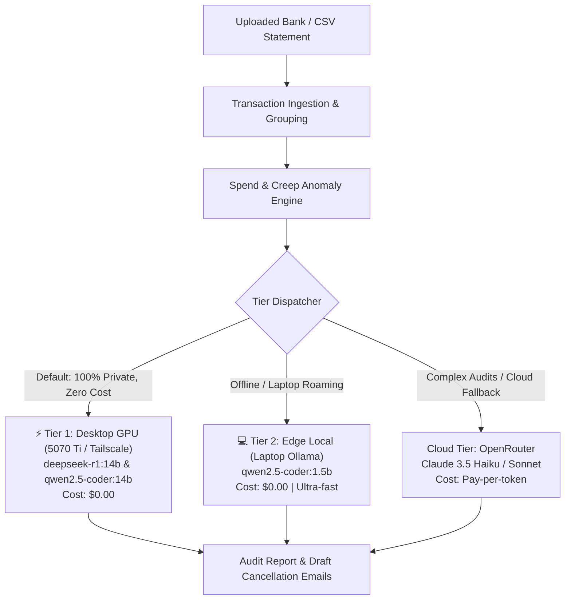

# 💳 FinAudit Engine

[](LICENSE)
[]()
[]()
[]()
[]()

> **Hybrid 3-Tier AI SaaS & Bank Statement Spend Auditor: Detect recurring subscription waste, identify creeping price increases, and draft automated cancellation or price-rollback emails.**

---

## 💡 Overview

Managing recurring software and subscription expenses across personal and business accounts is error-prone. **FinAudit Engine** parses raw CSV bank and credit card statements, groups recurring vendor transactions, detects anomalous price jumps, and generates professional cancellation and negotiation emails using a cost-efficient **3-tier hybrid AI architecture**.

---

## 🏛️ 3-Tier AI Architecture



---

## ✨ Key Features

- **Automated Recurring Detection**: Discovers hidden monthly/annual renewals across irregular statement transaction names.
- **Price Creep Alerts**: Flags services that have gradually increased rates by $\ge 15\%$ over time.
- **AI Negotiation & Cancellation Drafts**: Pre-drafts customer support emails demanding refund credits, cancellation, or rate match.
- **Multi-Tier Fallback Resilience**: Seamlessly falls back to local edge or OpenRouter if the desktop workstation is unreachable.
- **Interactive Web UI & CLI**: Full web dashboard for non-technical audits alongside a streamlined terminal CLI.

---

## 🚀 Quickstart

### 1. Installation
Using `uv`:
```bash
git clone https://github.com/dragpk247/finaudit-engine.git
cd finaudit-engine
uv sync
```

### 2. Web Dashboard
```bash
uv run python -m finaudit.cli serve
```
Open **http://localhost:8000** in your browser.

### 3. Command Line Audit
Audit any standard CSV bank export:
```bash
uv run python -m finaudit.cli audit sample_statement.csv
```

### 4. Check Inference Tier Health
Verify connection to your local laptop Ollama, desktop 5070 Ti, and OpenRouter:
```bash
uv run python -m finaudit.cli health
```

### 5. Run Test Suite
```bash
uv run pytest
```

---

## 📁 Project Structure

```text
finaudit-engine/
├── finaudit/
│   ├── cli.py             # Typer CLI application
│   ├── web.py             # FastAPI web application & dashboard
│   ├── parser.py          # CSV transaction normalizer & parser
│   ├── analyzer.py        # Subscription grouping & anomaly detector
│   └── ai/
│       ├── dispatcher.py  # 3-tier hybrid model router
│       └── prompts.py     # Cancellation & negotiation prompt templates
├── sample_statement.csv   # Mock financial statement for testing
├── tests/                 # Pytest automated test suite
├── pyproject.toml         # Dependencies and project metadata
└── README.md
```

---

## 📄 License
MIT License. Created by [dragpk247](https://github.com/dragpk247).
